<div align="center">

# 🩸 DEAD PIXEL

**Um pixel morreu em produção. Todo mundo que olhou virou zumbi.**

Shooter 2D top-down para navegador, sangrento e cheio de piadas de TI.
5 fases, 5 chefes, 6 armas e um terminal de verdade para digitar `rm -rf` em câmera lenta.

[](https://github.com/akanyane/dead-pixel/releases)
[](https://github.com/akanyane/dead-pixel/actions/workflows/release-please.yml)
[](LICENSE)


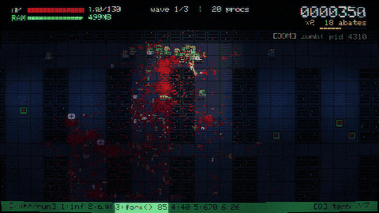

</div>

> [!WARNING]
> Contém violência pixelada, desmembramento e sangue digital. O menu tem uma opção para reduzir o gore.

---

## Índice

- [A história](#a-história)
- [Como jogar agora](#como-jogar-agora)
- [Controles](#controles)
- [O que torna o jogo diferente](#o-que-torna-o-jogo-diferente)
- [O terminal](#o-terminal)
- [Arsenal](#arsenal)
- [Bestiário](#bestiário)
- [Fases e chefes](#fases-e-chefes)
- [Pull requests (melhorias)](#pull-requests-melhorias)
- [Pontuação e sequências](#pontuação-e-sequências)
- [Dicas de sobrevivência](#dicas-de-sobrevivência)
- [Como foi feito](#como-foi-feito)
- [Estrutura do projeto](#estrutura-do-projeto)
- [Desenvolvimento](#desenvolvimento)
- [Publicando o jogo](#publicando-o-jogo)
- [Como as releases funcionam](#como-as-releases-funcionam)
- [Contribuindo](#contribuindo)
- [Licença](#licença)

---

## A história

> Sexta-feira, 17:58. Alguém fez deploy em produção.
>
> Um único pixel morreu no monitor de todo mundo. Quem olhou para ele parou de responder. Depois começou a morder.
>
> Você usa dark mode, por isso não viu nada. Ainda.

Você é o `root`, o último administrador de sistemas funcionando. Sua missão é descer do escritório até a origem do problema, passando pelo data center, pelos cabos que ninguém documentou e por um sistema escrito em 1974. No fim, você vai ter que olhar para o pixel.

## Como jogar agora

### Rodando o código

Você precisa do [Node.js](https://nodejs.org/) 20 ou mais recente.

```bash
git clone https://github.com/akanyane/dead-pixel.git
cd dead-pixel
npm install
npm run dev
```

Depois, abra o endereço que aparecer no terminal (normalmente http://localhost:5173).

### Usando uma release pronta

1. Baixe o `dead-pixel-vX.Y.Z.zip` na página de [releases](https://github.com/akanyane/dead-pixel/releases).
2. Extraia o arquivo e sirva a pasta com qualquer servidor estático:

   ```bash
   npx serve caminho/da/pasta
   ```

> [!NOTE]
> Abrir o `index.html` com dois cliques não funciona: navegadores bloqueiam módulos JavaScript em `file://`. É preciso usar um servidor, mesmo que local.

**Requisitos:** um navegador de desktop atual, teclado e mouse. O jogo não tem controles para celular. WebGL é recomendado para o efeito CRT, mas, sem ele, o jogo roda em Canvas 2D sem o efeito.

## Controles

| Ação | Tecla |
| --- | --- |
| Mover | `W` `A` `S` `D` ou setas |
| Mirar e atirar | Mouse (segure o botão esquerdo) |
| Dash, com invencibilidade | `Espaço` ou `Shift` |
| Golpe de teclado mecânico | `F` ou botão direito |
| Trocar de arma | `1` a `6` ou scroll |
| Abrir o terminal | `Q` ou `Enter` |
| Pausar | `Esc` ou `P` |
| Escolher um pull request | Clique, ou `1` `2` `3` |
| Reiniciar a fase depois de morrer | `R` |

Não existe recarga: o jogo é ágil demais para isso.

<div align="center">
  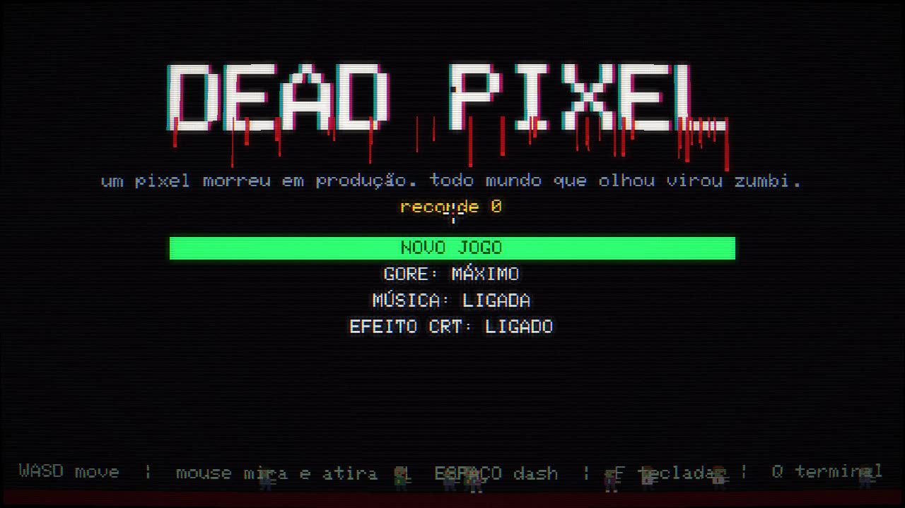
</div>

## O que torna o jogo diferente

- ⌨️ **Um terminal de verdade como poder especial.** O tempo quase para enquanto você digita comandos, com autocompletar e histórico.
- 🩸 **O chão guarda tudo.** Cada gota, tripa e explosão fica pintada no mapa até o fim da fase, e você deixa pegadas ao pisar no sangue.
- 🦴 **Gore com física.** Cabeças, braços, pernas, costelas e olhos voam, quicam, sangram no caminho e ficam onde caíram. Zumbis feridos perdem um braço e continuam vindo.
- 💥 **Peso em cada tiro.** Tremor de tela, congelamento nos abates pesados, recuo da câmera, cápsulas ejetadas, baterias que explodem em cadeia.
- 🖥️ **Cara de monitor velho.** Pós-processamento em WebGL com curvatura, scanlines, aberração cromática e glitches quando você apanha.
- 🎵 **Nenhum arquivo de mídia.** Sprites, efeitos e música são gerados por código. O jogo inteiro cabe em cerca de 46 KB comprimidos.
- 😂 **Piadas de TI em toda parte.** A barra de status imita o tmux, os abates aparecem como log de processos, e a tela de morte é um `Segmentation fault (core dumped)`.

## O terminal

Aperte `Q` a qualquer momento. O mundo fica em câmera lenta (8% da velocidade) e a música abafa enquanto você digita. Os comandos custam **RAM**, que você ganha matando inimigos e coletando pentes de memória.

- `Tab` completa o comando.
- `↑` e `↓` navegam pelo histórico.
- `Esc` fecha o terminal.

| Comando | Também aceita | Custo | Efeito |
| --- | --- | --- | --- |
| `ping` | `ping -c 1`, `ping localhost` | 60 MB | Atordoa os inimigos e apaga os tiros deles |
| `fork` | `fork()`, `./fork` | 150 MB | Cria um clone que atira por 20 s (até 4 ao mesmo tempo) |
| `overclock` | `oc`, `overclock --force` | 180 MB | 8 s com tiro e movimento acelerados |
| `revert` | `git revert`, `git revert head` | 200 MB | Recupera 50 de HP |
| `kill` | `kill -9`, `killall`, `pkill zumbi` | 250 MB | Raio em até 14 alvos próximos, com 240 de dano |
| `sudo` | `sudo su`, `sudo -i` | 300 MB | 6 s invencível, com dano em dobro |
| `rm` | `rm -rf`, `rm -rf /`, `rm -rf *` | 450 MB | Causa 500 de dano em tudo que está na tela |

<div align="center">
  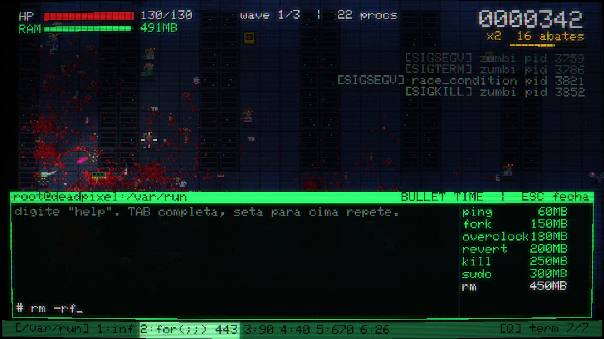
</div>

<details>
<summary>🥚 Comandos escondidos (spoilers)</summary>

Vários comandos não têm utilidade alguma, e esse é o objetivo: `ls`, `pwd`, `whoami`, `man`, `date`, `uptime`, `ps`, `top`, `git blame`, `git status`, `git push --force`, `npm install`, `coffee`, `hello world`, `cat /dev/urandom`, `chatgpt`, `exit`.

- `vim` te prende no terminal até você descobrir como sair. Quem consegue ganha 100 MB de RAM.
- `sudo make me a sandwich` dá 1 de HP. Sem `sudo`, não funciona.

</details>

## Arsenal

Você começa só com a `printf()`. As outras armas aparecem ao longo do jogo, e cada uma é uma piada com o que o comando faz.

| # | Arma | Tipo | Dano | Intervalo | Munição máx. | Como conseguir |
| --- | --- | --- | --- | --- | --- | --- |
| 1 | `printf()` | Pistola | 13 | 0,20 s | Infinita | Inicial |
| 2 | `for(;;)` | Submetralhadora | 9 | 0,07 s | 640 | Caixa após a 1ª wave da fase 1 |
| 3 | `fork()` | Escopeta (9 projéteis) | 11 cada | 0,62 s | 90 | Vencer o Scrum Master |
| 4 | `kill -9` | Railgun que atravessa tudo | 170 | 0,85 s | 40 | Vencer o Kernel Panic |
| 5 | `rm -rf` | Lança-chamas | 5 + fogo | 0,035 s | 800 | Vencer a Hidra |
| 6 | `DROP TABLE` | Lança-foguetes em área | 140 | 0,95 s | 26 | Vencer o Monolito |

O **teclado mecânico** (`F`) é o seu ataque corpo a corpo. Ele causa 70 de dano em arco, empurra forte, solta teclas pelo chão e cura 3 de HP a cada abate. É a melhor saída quando uma horda encurrala você.

## Bestiário

| Inimigo | HP | Velocidade | O que faz |
| --- | --- | --- | --- |
| **zumbi** (`<defunct>`) | 34 | 30 | Anda e morde. Perde um braço quando ferido |
| **bug** | 8 | 78 | Enxame rápido em ziguezague |
| **race condition** | 20 | 96 | Corre de forma errática e nunca chega na hora certa |
| **recrutador** | 42 | 34 | Mantém distância e dispara "vagas incríveis" |
| **memory leak** | 80 | 20 | Deixa poças que ferem e atrasam; ao morrer, vira 3 filhotes |
| **null pointer** | 46 | 44 | Fica intangível, teleporta para perto de você e atira `null` |
| **segfault** | 26 | 64 | Corre até você, acende o pavio e explode. Morto antes disso, fere os vizinhos |
| **stack overflow** | 300 | 18 | Torre de caixas; ao morrer, libera 4 zumbis |

O HP cresce 16% e a velocidade cresce 4% a cada fase. As baterias de nobreak amarelas explodem quando atingidas: use-as a seu favor.

## Fases e chefes

Cada fase tem waves de inimigos e termina em um chefe. Depois de cada wave, você escolhe uma melhoria. Ao morrer, recomeça do início da fase, com tudo o que tinha quando entrou nela.

### 1. Open Space, `~/startup`

O escritório depois do expediente: mesas, monitores ainda ligados e post-its.

**Chefe: Scrum Master** — *"Bom dia, time! Rapidinho: só 15 minutinhos."*
Lança tickets (`P0`, `BUG`, `TODO`) e convoca a daily, que invoca reforços. Antes de cada **sprint**, marca uma linha vermelha e dispara nela. Se bater na parede, fica atordoado e vulnerável.

<div align="center">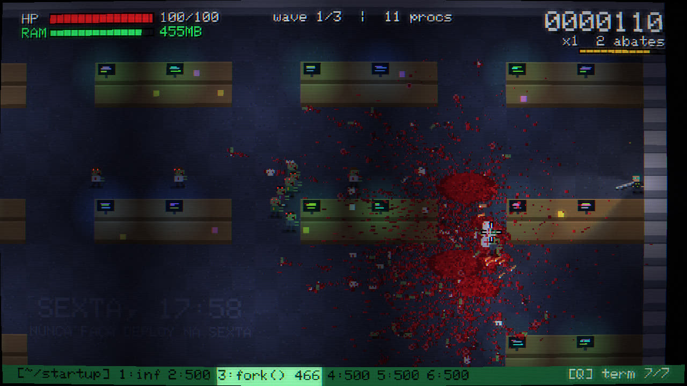</div>

### 2. Data Center, `/var/run`

Corredores estreitos entre racks, LEDs piscando e luz azul fria.

**Chefe: Kernel Panic** — *"Not syncing: Attempted to kill init!"*
Um processador gigante que alterna espirais de tiros hexadecimais, anéis de projéteis, invocações e um laser que varre a sala.

<div align="center">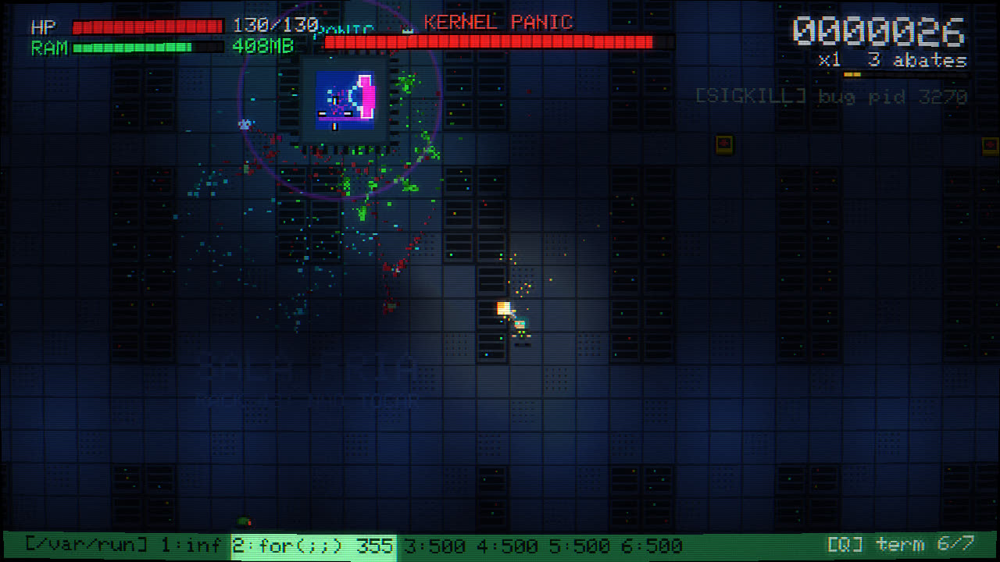</div>

### 3. Undernet, `/dev/null`

Cavernas geradas proceduralmente, cabos sem documentação e poças tóxicas brilhando no escuro.

**Chefe: Hidra de Microsserviços** — *"Cada serviço tem uma única responsabilidade. A minha é te devorar."*
Corte um nó e nascem dois menores e mais rápidos, em três gerações. No total, são 7 nós para destruir.

<div align="center">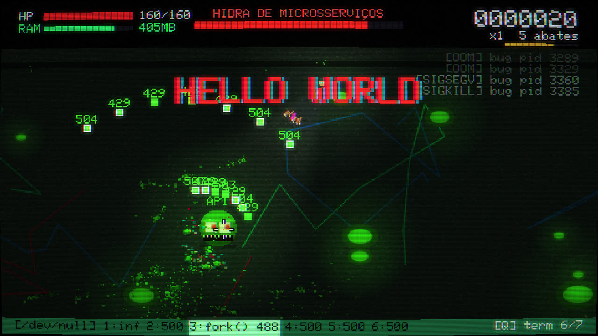</div>

### 4. Produção, `/prod`

Tudo vermelho. **Faixas de deploy** cruzam o mapa: quando a área pisca, saia dali. Elas queimam você, mas também queimam os zumbis.

**Chefe: O Monolito Legado** — *"IDENTIFICATION DIVISION. PROGRAM-ID. MORTE."*
Imóvel e blindado, recebe só 30% do dano até disparar seus lasers e abrir as portas. Ataque com tudo quando o núcleo vermelho aparecer.

<div align="center">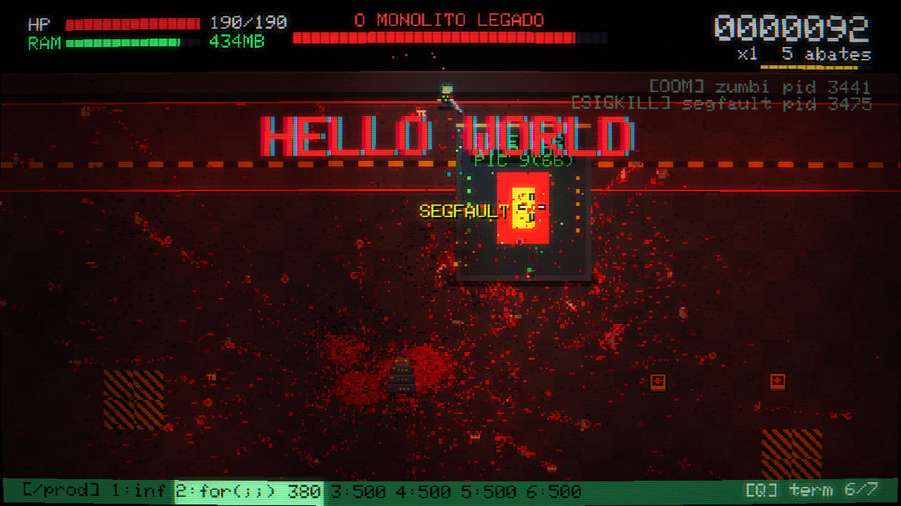</div>

### 5. O Pixel, `/dev/pixel`

A sala fica branca, e o sangue ganha um contraste absurdo.

**Chefe: O Pixel Morto** — *"1 x 1 px. é só isso. sempre foi só isso."*
Começa minúsculo, teleportando pela sala, e cresce em três fases, enquanto corrompe o chão e dispara lasers giratórios.

<div align="center">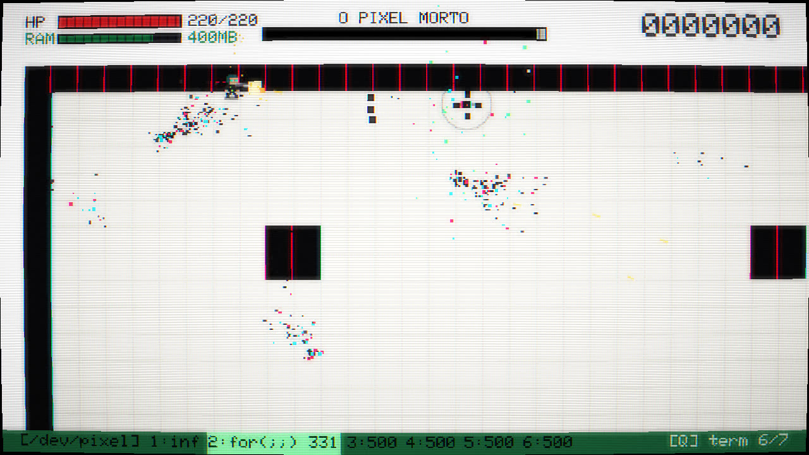</div>

## Pull requests (melhorias)

Depois de cada wave, três pull requests aparecem, e você faz o merge de um. A combinação muda a cada partida.

<div align="center">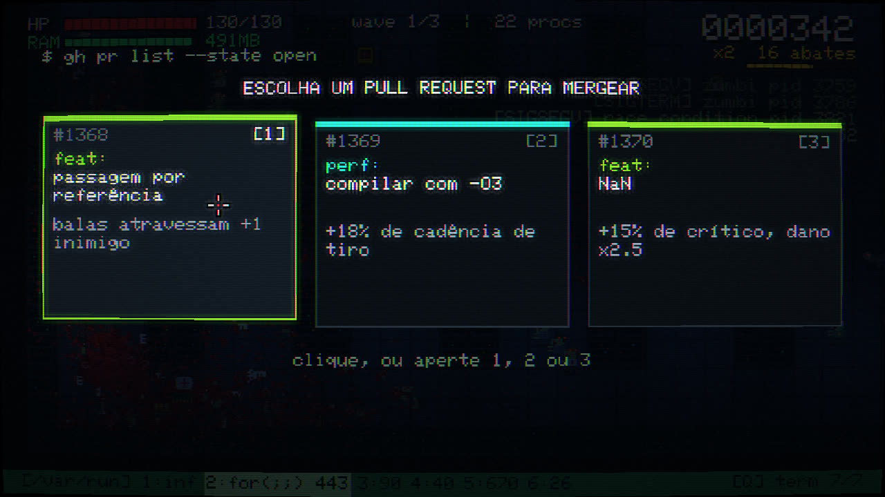</div>

| Tipo | Título | Efeito | Máx. |
| --- | --- | --- | --- |
| `feat` | dano++ | +25% de dano em todas as armas | — |
| `perf` | compilar com -O3 | +18% de cadência de tiro | — |
| `perf` | remover o sleep(1000) | +12% de velocidade | 4 |
| `fix` | tratar exceção | +30 de HP máximo e cura 30 | — |
| `feat` | passagem por referência | Balas atravessam +1 inimigo | 4 |
| `feat` | retry com backoff | Balas ricocheteiam +1 vez | 3 |
| `feat` | paralelismo | +1 projétil por disparo | 3 |
| `feat` | NaN | +15% de crítico, com dano x2,5 | 4 |
| `feat` | exceção não tratada | +12% de chance de explodir ao matar | 4 |
| `chore` | download more ram | +256 MB de RAM máxima e +50% de ganho | 3 |
| `refactor` | garbage collector | +1 HP a cada 4 abates | 3 |
| `perf` | cache de dash | -25% de recarga do dash | 3 |
| `feat` | merge conflict | O dash mói quem estiver na frente | 2 |
| `chore` | npm install ímã | Atrai itens de muito mais longe | 2 |
| `feat` | servidor em chamas | Tiros incendeiam o alvo | 2 |
| `chore` | aumentar o buffer | +50% de munição máxima e recarga total | 2 |
| `feat` | cron job | Um pixel afiado orbita e corta zumbis | 4 |
| `feat` | firewall | Quem te toca leva 40 de dano | 3 |
| `fix` | backup da sexta | Revive uma vez com metade do HP | 1 |
| `feat` | teclado mecânico | Golpe do teclado com +100% de dano | 2 |

## Pontuação e sequências

Cada abate em sequência renova um timer de 3,5 segundos, e levar dano encurta esse tempo. O multiplicador de pontos sobe +1 a cada 10 abates seguidos.

| Abates | Anúncio |
| --- | --- |
| 5 | HELLO WORLD |
| 10 | LOOP INFINITO |
| 20 | RECURSÃO |
| 35 | STACK OVERFLOW |
| 50 | KERNEL PANIC |
| 75 | P = NP |
| 100 | SINGULARIDADE |
| 150 | SUDO DEUS |
| 250 | ALGUÉM CHAMA O RH |

O progresso, o recorde e as opções ficam salvos no `localStorage` do navegador. Não há servidor nem conta.

## Dicas de sobrevivência

1. **Use o dash para atravessar, não só para fugir.** Você fica invencível durante os 0,17 s do movimento.
2. **Não guarde RAM demais.** Um `ping` de 60 MB limpa a tela de tiros em um momento de desespero.
3. **Decore comandos curtos.** `rm` + `Enter` é mais rápido que `rm -rf /`, e `↑` + `Enter` repete o último.
4. **Atire nas baterias quando a horda passar por elas.** As explosões causam reação em cadeia.
5. **Mate os segfaults de longe.** Explodindo perto dos outros zumbis, eles trabalham para você.
6. **Na fase 4, faça os zumbis passarem pelas faixas de deploy.** Quem está nelas leva 400 de dano.
7. **Contra o Monolito, economize a munição boa** para quando o núcleo estiver exposto.

## Como foi feito

O jogo é TypeScript puro sobre Canvas 2D, sem engine e sem dependências em runtime. O Vite e o TypeScript são usados só em desenvolvimento e no build.

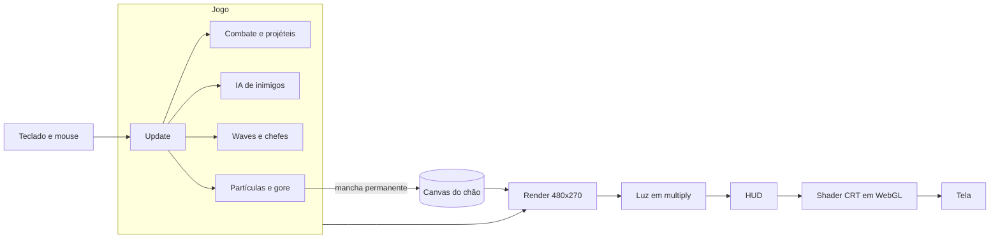

| Sistema | Como funciona |
| --- | --- |
| **Resolução** | Tudo é desenhado em 480x270 e ampliado com pixels nítidos, o que garante a aparência de pixel art. |
| **Gore persistente** | O chão é um canvas único e cada mancha é pintada nele de vez. O sangue acumulado não custa nada por frame, então o mapa pode ficar coberto sem perder desempenho. |
| **Sprites** | São matrizes de texto convertidas em canvas ao iniciar. A fonte também é um bitmap 5x7 no código, com acentos do português compostos a partir da letra base. |
| **Caminho até o jogador** | Um único campo de fluxo (BFS sobre os tiles) é recalculado cerca de 4 vezes por segundo e compartilhado por toda a horda. |
| **Colisões** | Um hash espacial limita as comparações entre balas e inimigos, e entre os próprios inimigos, aos vizinhos próximos. |
| **Luz** | Luzes aditivas são somadas em um canvas separado, aplicado em `multiply` sobre o mundo. Tiros e olhos dos zumbis são desenhados depois, para brilhar no escuro. |
| **Áudio** | Web Audio do início ao fim: efeitos com osciladores e ruído filtrado, mais um sequenciador com trilhas diferentes por fase. |
| **CRT** | Um fragment shader aplica curvatura, scanlines, bloom, aberração cromática e glitches. Sem WebGL, o jogo continua funcionando sem esse efeito. |
| **Arenas** | O layout é gerado a cada partida: mesas e salas, corredores de racks, cavernas com autômato celular. Uma checagem de conectividade evita bolsões isolados. |

## Estrutura do projeto

```text
dead-pixel/
├── index.html
├── src/
│   ├── main.ts             # Loop principal, menu e máquina de estados das telas
│   ├── core/
│   │   ├── audio.ts        # Efeitos e música sintetizados
│   │   ├── crt.ts          # Pós-processamento WebGL
│   │   ├── font.ts         # Fonte bitmap com acentos
│   │   ├── input.ts        # Teclado e mouse
│   │   └── util.ts         # Matemática e helpers
│   └── game/
│       ├── data.ts         # ⭐ Inimigos, armas, perks e fases: balanceie aqui
│       ├── game.ts         # Estado, waves, save e progressão
│       ├── combat.ts       # Jogador, projéteis, dano e explosões
│       ├── enemies.ts      # IA de inimigos e chefes
│       ├── terminal.ts     # Comandos do terminal
│       ├── fx.ts           # Gore, partículas e manchas
│       ├── map.ts          # Geração e pintura das arenas
│       ├── render.ts       # Mundo e iluminação
│       ├── hud.ts          # Interface e telas
│       └── sprites.ts      # Pixel art em texto
├── docs/screenshots/       # Imagens deste README
├── .github/workflows/      # Automação de releases
└── release-please-config.json
```

## Desenvolvimento

| Comando | O que faz |
| --- | --- |
| `npm run dev` | Servidor de desenvolvimento com recarga automática |
| `npm run build` | Typecheck e build de produção em `dist/` |
| `npm run preview` | Serve o build de produção localmente |
| `npm run typecheck` | Só o typecheck |

Em modo de desenvolvimento, o jogo fica em `window.__g`, e `?god` na URL liga a invencibilidade. Nada disso existe no build de produção.

```js
__g.startLevel(4);     // vai para a fase final (0 a 4)
__g.beginPlay();       // pula a história
__g.player.ram = 512;  // enche a RAM
```

O projeto ainda não tem testes automatizados.

## Publicando o jogo

`npm run build` gera um site estático em `dist/`, com caminhos relativos. Ele funciona em qualquer hospedagem estática, inclusive em subpastas, como Vercel, Netlify, Cloudflare Pages ou GitHub Pages.

## Como as releases funcionam

As versões são automatizadas pelo [release-please](https://github.com/googleapis/release-please):

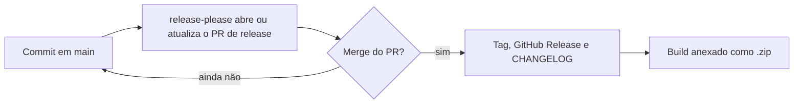

1. Os commits em `main` seguem o [Conventional Commits](https://www.conventionalcommits.org/pt-br/). `feat:` sobe a versão minor, `fix:` sobe a patch, e `feat!:` sobe a major.
2. A action mantém um PR aberto com a próxima versão e o changelog.
3. Quando esse PR é mergeado, a release é publicada e o jogo compilado é anexado a ela.

## Contribuindo

Ideias, bugs e pull requests são bem-vindos. Veja o [CONTRIBUTING.md](CONTRIBUTING.md) para preparar o ambiente e saber onde mexer em cada coisa.

## Licença

[MIT](LICENSE). Faça backup.

<div align="center">
  <br>
  <sub>Nunca faça deploy na sexta.</sub>
</div>
