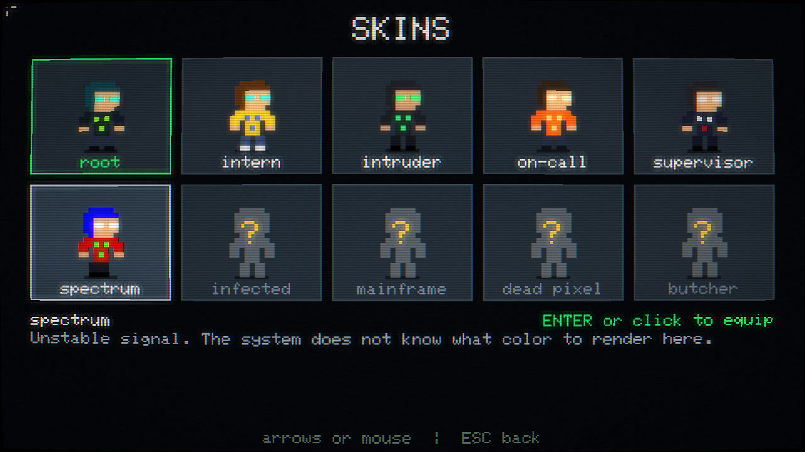
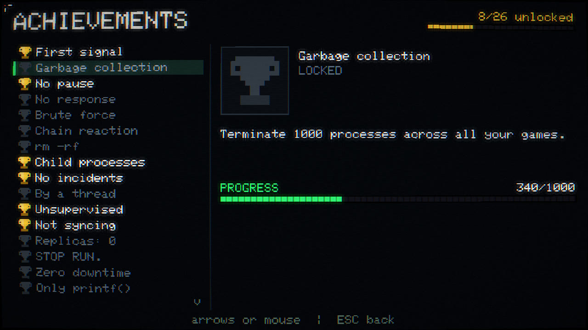
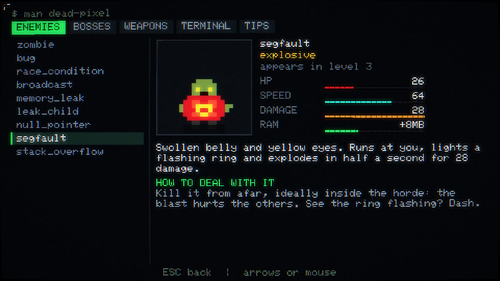
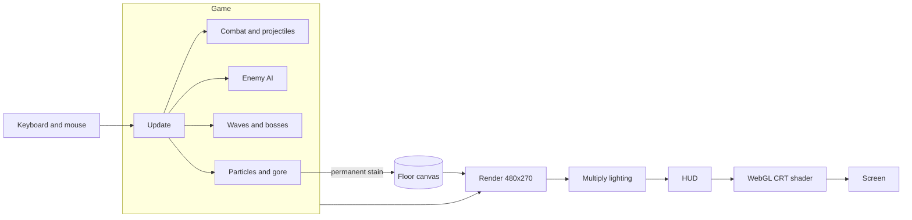
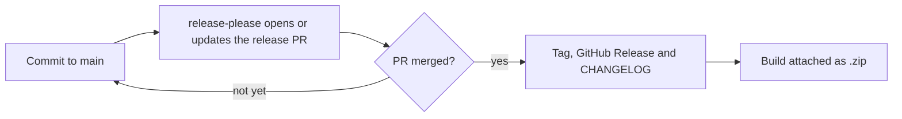

<div align="center">

# 🩸 DEAD PIXEL

**Friday, 17:58. A pixel went dark. Nobody answered after that.**

A top-down 2D tech-horror mystery shooter for the browser.
5 levels, 5 bosses, 6 weapons, an endless mode, a daily run and a real terminal for typing `rm -rf` in slow motion.

### [](https://akanyane.github.io/dead-pixel/)

<sub>Free, in the browser, nothing to install. Keyboard and mouse, gamepad or touch.</sub>

[](https://github.com/akanyane/dead-pixel/releases)
[](https://github.com/akanyane/dead-pixel/actions/workflows/ci.yml)
[](https://github.com/akanyane/dead-pixel/actions/workflows/release-please.yml)
[](LICENSE)


</div>

> [!WARNING]
> Contains pixelated violence, dismemberment and digital blood. The options menu can tone the gore down.

---

## Contents

- [The story](#the-story)
- [How to play](#how-to-play)
- [Game modes](#game-modes)
- [Controls](#controls)
- [What makes it different](#what-makes-it-different)
- [The terminal](#the-terminal)
- [Arsenal](#arsenal)
- [Bestiary](#bestiary)
- [Levels and bosses](#levels-and-bosses)
- [Patches (upgrades)](#patches-upgrades)
- [Skins](#skins)
- [Achievements](#achievements)
- [Options and accessibility](#options-and-accessibility)
- [Languages](#languages)
- [In-game manual and tips](#in-game-manual-and-tips)
- [Score and streaks](#score-and-streaks)
- [Survival tips](#survival-tips)
- [How it was made](#how-it-was-made)
- [Project structure](#project-structure)
- [Development](#development)
- [Deploying the game](#deploying-the-game)
- [How releases work](#how-releases-work)
- [Contributing](#contributing)
- [License](#license)

---

## The story

> Friday, 17:58. Every monitor at Vesper Systems shows the same screen.
>
> Gray, uniform. In the exact center, a single dark pixel.
>
> Nobody blinks. Then, all of them stand up at the same time.
>
> On your terminal, someone you do not know writes: *"Go down."*

You are `root`. Guided by an anonymous operator, you go down floor by floor: from the office to the data center, then into the cables nobody documented, and to whatever is running at the bottom of it all.

Each boss you defeat unlocks a recovered log that reveals more of what happened. Not everything the operator says can be trusted, and the game leaves clues for those who pay attention: in the kill feed, in the enemy shots and in the terminal itself.

> [!TIP]
> The story works best without spoilers. Play to the end, then watch the game's boot screen again.

## How to play

### In the browser

Open **[akanyane.github.io/dead-pixel](https://akanyane.github.io/dead-pixel/)** and that's it. The site updates itself on every change to `main`.

### On a phone or tablet

Hold the device sideways: in portrait the game pauses and asks you to turn it. On Android, the first tap also switches to fullscreen and locks the screen to landscape. You can toggle fullscreen at any time under **OPTIONS > FULLSCREEN**.

### Install it and play offline

The game is a Progressive Web App. After the first visit, everything it needs is cached, so it keeps working without a connection.

- **Chrome, Edge and Android:** use **INSTALL THE GAME** in the main menu (it shows up when the browser allows installing), or the install icon in the address bar.
- **iPhone and iPad:** in Safari, tap **Share > Add to Home Screen**. The installed app opens in fullscreen.

New releases are picked up the next time the game opens with a connection.

### From source

You need [Node.js](https://nodejs.org/) 20 or newer.

```bash
git clone https://github.com/akanyane/dead-pixel.git
cd dead-pixel
npm install
npm run dev
```

Then open the address printed in the terminal (usually http://localhost:5173).

### From a release build

1. Download `dead-pixel-vX.Y.Z.zip` from the [releases](https://github.com/akanyane/dead-pixel/releases) page.
2. Extract it and serve the folder with any static server:

   ```bash
   npx serve path/to/folder
   ```

> [!NOTE]
> Double-clicking `index.html` won't work: browsers block JavaScript modules on `file://`. You need a server, even a local one.

**Requirements:** a modern browser and a keyboard and mouse, a gamepad or a touch screen. WebGL is recommended for the CRT effect; without it, the game runs on plain Canvas 2D without the effect.

## Game modes

Pick a mode under **PLAY** in the main menu.

| Mode | What it is |
| --- | --- |
| **Story** | The 5 levels and the mystery. Choose a difficulty when you start: |
| ↳ Easy | Enemies have 25% less HP and deal 40% less damage. Score is worth 0.5x |
| ↳ Normal | The game as it was meant to be played |
| ↳ Hard | 20% more enemies, 25% more HP, 35% more damage. Score is worth 1.5x |
| ↳ Hardcore | Like hard, but dying erases the run. Score is worth 2x |
| **Endless** | Unlocked after the ending. Arenas cycle through the five themes, with 4 waves and a boss each. Enemies get tougher every wave, and bosses come back much stronger on every loop. One life |
| **Daily run** | Same map, same waves and same patches for everyone on the same day (UTC). One life. Press `C` on the death screen to copy your result |

Endless and the daily run are always played on normal, so records stay comparable. Your best endless wave and today's best daily run are shown in the menu.

## Controls

| Action | Key |
| --- | --- |
| Move | `W` `A` `S` `D` or arrow keys |
| Aim and shoot | Mouse (hold left button) |
| Dash, with invincibility | `Space` or `Shift` |
| Crowbar strike | `F` or right button |
| Switch weapon | `1` to `6` or scroll wheel |
| Open the terminal | `Q` or `Enter` |
| Pause | `Esc` or `P` |
| Pick a patch | Click, or `1` `2` `3` |
| Restart the level after dying | `R` |
| Copy your arcade result | `C` on the death screen |

There is no reloading. Movement, dash, strike, terminal and pause can be remapped under **OPTIONS > CONTROLS**.

### Gamepad

Any standard gamepad works; it takes over as soon as you touch it.

| Action | Button |
| --- | --- |
| Move / aim | Left stick / right stick |
| Shoot | `RT` |
| Dash | `LT` or `A` |
| Crowbar strike | `X` |
| Switch weapon | `LB` / `RB` |
| Terminal | `Y`, then pick a command with the d-pad and run it with `A` |
| Pause | `Start` |

Menus work with the d-pad, `A` to confirm and `B` to go back.

### Touch

Drag on the left half of the screen to move and on the right half to aim and shoot. Buttons on the right handle dash, strike, weapon and the terminal, where you tap a command to run it. The pause button sits under the health bar.

<div align="center">
  
</div>

## What makes it different

- 🕵️ **A mystery told by the system itself.** Operator messages, recovered logs and an ending that changes the meaning of everything you did.
- ⌨️ **A real terminal as your special power.** Time almost stops while you type commands, with autocomplete and history.
- 🩸 **The floor remembers everything.** Every drop, gut and explosion stays painted on the map until the level ends, and you leave footprints when you step in blood.
- 🦴 **Physics-based gore.** Heads, arms, legs, ribs and eyes fly, bounce, bleed along the way and stay where they land. Wounded zombies lose an arm and keep coming.
- 💥 **Every shot has weight.** Screen shake, hit-stop on heavy kills, camera kick, ejected shell casings, batteries that explode in chains.
- 🖥️ **Looks like an old monitor.** WebGL post-processing with curvature, scanlines, chromatic aberration and glitches when you get hit.
- 🎵 **Zero media files.** Sprites, sound effects and music are all generated by code. The whole game fits in about 75 KB gzipped.

## The terminal

Press `Q` at any time. The world drops to slow motion (8% speed) and the music muffles while you type. Commands cost **RAM**, which you earn by killing enemies and picking up memory sticks.

- `Tab` completes the command.
- `↑` and `↓` browse the history.
- `Esc` closes the terminal.

| Command | Also accepts | Cost | Effect |
| --- | --- | --- | --- |
| `ping` | `ping -c 1`, `ping localhost` | 60 MB | Stuns enemies and erases their shots |
| `fork` | `fork()`, `./fork` | 150 MB | Spawns a clone that shoots for 20 s (up to 4 at once) |
| `overclock` | `oc`, `overclock --force` | 180 MB | 8 s of faster shooting and movement |
| `revert` | `git revert`, `git revert head` | 200 MB | Restores 50 HP |
| `kill` | `kill -9`, `killall`, `pkill zombie` | 250 MB | Lightning on up to 14 nearby targets, 240 damage each |
| `sudo` | `sudo su`, `sudo -i` | 300 MB | 6 s of invincibility with double damage |
| `rm` | `rm -rf`, `rm -rf /`, `rm -rf *` | 450 MB | Deals 500 damage to everything on screen |

<div align="center">
  
</div>

> [!TIP]
> The terminal accepts more than the listed commands. Try what you would type to investigate a server: the answers tell part of the story.

## Arsenal

You start with only `printf()`. The other weapons show up along the way, each named after what the command does.

| # | Weapon | Type | Damage | Interval | Max ammo | How to get it |
| --- | --- | --- | --- | --- | --- | --- |
| 1 | `printf()` | Pistol | 13 | 0.20 s | Infinite | Starting weapon |
| 2 | `for(;;)` | Submachine gun | 9 | 0.07 s | 640 | Crate after wave 1 of level 1 |
| 3 | `fork()` | Shotgun (9 pellets) | 11 each | 0.62 s | 90 | Defeat the Supervisor |
| 4 | `kill -9` | Railgun that pierces everything | 170 | 0.85 s | 40 | Defeat Kernel Panic |
| 5 | `rm -rf` | Flamethrower | 5 + fire | 0.035 s | 800 | Defeat the Hydra |
| 6 | `DROP TABLE` | Area rocket launcher | 140 | 0.95 s | 26 | Defeat the Monolith |

The **crowbar** (`F`) is your melee attack. It deals 70 damage in an arc, knocks back hard and heals 3 HP per kill. It's your best way out when a horde corners you.

## Bestiary

| Enemy | HP | Speed | What it does |
| --- | --- | --- | --- |
| **zombie** (`<defunct>`) | 34 | 30 | Walks and bites. Loses an arm when wounded |
| **bug** | 8 | 78 | Fast zigzagging swarm |
| **race_condition** | 20 | 96 | Runs erratically and never arrives at the right time |
| **broadcast** | 42 | 34 | Keeps its distance and fires data packets from behind the horde |
| **memory_leak** | 80 | 20 | Leaves puddles that hurt and slow you; splits into 3 fragments on death |
| **null_pointer** | 46 | 44 | Turns intangible, teleports next to you and shoots `null` |
| **segfault** | 26 | 64 | Runs at you, lights its fuse and explodes. Killed early, it hurts its neighbors |
| **stack_overflow** | 300 | 18 | A tower of crates; releases 4 zombies on death |

HP grows 16% and speed grows 4% each level. Yellow UPS batteries explode when hit: use them to your advantage.

## Levels and bosses

Each level has enemy waves and ends with a boss. After each wave you apply a patch. If you die, you restart from the beginning of the level with everything you had when you entered it.

### 1. Open Space, `~/startup`

The Vesper office floor after hours: desks, monitors still on and nobody answering.

**Boss: The Supervisor.** Throws fans of alerts and calls the others to gather around it. Before each **charge**, it draws a red line and dashes along it. If it hits a wall, it gets stunned and vulnerable.

<div align="center"></div>

### 2. Data Center, `/var/run`

Narrow corridors between racks, blinking LEDs and cold blue light. The room shouldn't be warm.

**Boss: Kernel Panic.** A giant processor that alternates shot spirals, projectile rings, summons and a laser that sweeps the room.

<div align="center"></div>

### 3. Undernet, `/dev/null`

A floor that isn't on the plans: procedurally generated caves, undocumented cables and toxic puddles glowing in the dark.

**Boss: Microservice Hydra.** Cut one node and two smaller, faster ones are born, across three generations. That's 7 nodes to destroy in total.

<div align="center"></div>

### 4. Production, `/prod`

Everything is red. **Deploy strips** cross the map: when the area flashes, get out. They burn you, but they burn enemies too.

**Boss: The Legacy Monolith.** Immobile and armored, it takes only 30% damage until it fires its lasers and opens its doors. Hit it with everything when the red core shows.

<div align="center"></div>

### 5. The Pixel, `/dev/pixel`

The room turns white, and the blood gets an absurd amount of contrast.

**Boss: The Dead Pixel.** Starts tiny, teleporting around the room, and grows through three phases while it corrupts the floor and fires spinning lasers.

<div align="center"></div>

## Patches (upgrades)

After each wave, the operator sends three patches and you apply one. The combination changes every run.

<div align="center"></div>

| Type | Title | Effect | Max |
| --- | --- | --- | --- |
| `feat` | elevated privileges | +25% damage on all weapons | — |
| `perf` | compile with -O3 | +18% fire rate | — |
| `perf` | reduced latency | +12% movement speed | 4 |
| `fix` | redundancy | +30 max HP and heals 30 | — |
| `feat` | pass by reference | Bullets pierce +1 enemy | 4 |
| `feat` | retry with backoff | Bullets bounce +1 time | 3 |
| `feat` | parallelism | +1 projectile per shot | 3 |
| `feat` | weak point | +15% crit chance, x2.5 damage | 4 |
| `feat` | unhandled exception | +12% chance to explode on kill | 4 |
| `chore` | extra allocation | +256 MB max RAM and +50% gain | 3 |
| `refactor` | garbage collector | +1 HP every 4 kills | 3 |
| `perf` | instant response | -25% dash cooldown | 3 |
| `feat` | collision | The dash shreds whoever is in front | 2 |
| `chore` | automatic collection | Pulls items from much farther away | 2 |
| `feat` | overheating | Shots set the target on fire | 2 |
| `chore` | expanded buffer | +50% max ammo and full refill | 2 |
| `feat` | cron job | A sharp pixel orbits and slices enemies | 4 |
| `feat` | firewall | Whoever touches you takes 40 damage | 3 |
| `fix` | restore point | Revive once with half HP | 1 |
| `feat` | brute force | Crowbar strike with +100% damage | 2 |

## Skins

Pick your `root`'s outfit under **SKINS** in the main menu. Four are available from the start and six are earned by playing. Unlocks are saved, even if you start a new game.

<div align="center"></div>

| Skin | How to unlock |
| --- | --- |
| root, intern, intruder, on-call | Available from the start |
| supervisor | Defeat the Supervisor |
| spectrum (constantly shifts color) | Defeat Kernel Panic |
| infected | Defeat the Microservice Hydra |
| mainframe | Defeat the Legacy Monolith |
| dead pixel | Defeat the Dead Pixel |
| butcher | Reach a streak of 100 kills |

Skins are cosmetic only, and each one has its own dash trail.

## Achievements

There are 28 achievements, available from the main menu and the pause menu, with progress bars on the ones that count something. They're saved in your browser. Some are hidden and only reveal themselves once unlocked, so they don't spoil the story.

<div align="center"></div>

They reward combat (streaks, total kills, a single `rm -rf` terminating 20 processes), challenges (beating a boss without taking damage, finishing a level with only `printf()`, finishing the story on hard, reaching wave 25 in endless) and investigating through the terminal.

## Options and accessibility

| Option | What it does |
| --- | --- |
| **Gore** | Maximum, normal or mild |
| **Music** and **sound effects** | Separate volumes in 10% steps; left and right arrows adjust them |
| **CRT effect** | Turns the old-monitor shader on or off |
| **Tips and cards** | New enemy cards, death tips and context hints |
| **High contrast hazards** | Enemy shots get a black and white outline, danger zones get diagonal stripes, and warning lines turn white, so nothing depends on telling red from green |
| **Controls** | Remap movement, dash, strike, terminal and pause |
| **Fullscreen** | Fills the whole screen (where the browser supports it) |
| **Language** | English, Portuguese or Spanish |

## Languages

The whole game is available in **English**, **Portuguese** and **Spanish**, including the story, logs, manual, terminal replies and even the text painted on the floor. On first launch, the language follows your browser. To change it, use `IDIOMA / LANGUAGE` in the main menu or in the options.

Terminal commands (`rm -rf`, `kill -9`...) are the same in every language.

## In-game manual and tips

The game explains itself, and you can turn the cards and tips off in **OPTIONS**:

- **Manual:** available from the main menu and the pause menu, with stats and strategy for every enemy, boss, weapon and command, plus a tips tab.
- **New enemy card:** the first time an enemy or boss appears, the game pauses and shows what it does and how to deal with it.
- **Death screen:** shows who killed you and how to avoid it next time.
- **Context tips:** for example, a reminder to type `revert` when your HP is low.
- **Level screen:** each level starts with a gameplay tip.

<div align="center"></div>

## Score and streaks

Each kill in a streak resets a 3.5-second timer, and taking damage shortens it. The score multiplier goes up by +1 every 10 consecutive kills.

| Kills | Announcement |
| --- | --- |
| 5 | TERMINATED |
| 10 | CHAINED |
| 20 | RECURSION |
| 35 | STACK OVERFLOW |
| 50 | KERNEL PANIC |
| 75 | MEMORY FREED |
| 100 | NO RESPONSE |
| 150 | CAN THEY FEEL IT? |
| 250 | WHO ARE YOU? |

Progress, high scores, arcade records, skins, achievements and options are saved in the browser's `localStorage`. There's no server and no account.

## Survival tips

1. **Dash through things, not just away from them.** You're invincible for the 0.17 s of the move.
2. **Don't hoard RAM.** A 60 MB `ping` clears the screen of shots in a pinch.
3. **Memorize short commands.** `rm` + `Enter` is faster than `rm -rf /`, and `↑` + `Enter` repeats the last one.
4. **Shoot the batteries when the horde walks past them.** The explosions chain.
5. **Kill segfaults from a distance.** When they blow up next to other zombies, they work for you.
6. **In level 4, lure zombies through the deploy strips.** Anything inside takes 400 damage.
7. **Against the Monolith, save your best ammo** for when the core is exposed.

## How it was made

The game is plain TypeScript on top of Canvas 2D, with no engine and no runtime dependencies. Vite and TypeScript are only used for development and the build.



| System | How it works |
| --- | --- |
| **Resolution** | Everything is drawn at 480x270 and upscaled with crisp pixels, which keeps the pixel-art look. |
| **Persistent gore** | The floor is a single canvas and each stain is painted onto it once. Accumulated blood costs nothing per frame, so the map can get covered without losing performance. |
| **Sprites** | Text matrices converted to canvases at startup. The font is also a 5x7 bitmap in code, with Portuguese and Spanish accents composed from the base letter. |
| **Pathfinding** | A single flow field (BFS over the tiles) is recomputed about 4 times per second and shared by the whole horde. |
| **Collisions** | A spatial hash limits bullet-vs-enemy and enemy-vs-enemy checks to nearby neighbors. |
| **Lighting** | Additive lights are summed on a separate canvas and applied with `multiply` over the world. Shots and zombie eyes are drawn afterwards so they glow in the dark. |
| **Languages** | Strings live in `i18n.ts`, and every language is typed from the same shape: a missing translation breaks the build. |
| **Audio** | Web Audio from start to finish: effects from oscillators and filtered noise, plus a sequencer with a different track per level. |
| **CRT** | A fragment shader applies curvature, scanlines, bloom, chromatic aberration and glitches. Without WebGL, the game still works without it. |
| **Arenas** | The layout is generated every run: desks and rooms, rack corridors, cellular-automaton caves. A connectivity check prevents isolated pockets. |

## Project structure

```text
dead-pixel/
├── index.html
├── src/
│   ├── main.ts             # Main loop, menu and screen state machine
│   ├── core/
│   │   ├── audio.ts        # Synthesized effects and music
│   │   ├── crt.ts          # WebGL post-processing
│   │   ├── font.ts         # Bitmap font with accents
│   │   ├── input.ts        # Keyboard, mouse, gamepad, touch and key bindings
│   │   ├── platform.ts     # Fullscreen, rotate prompt, offline cache and install prompt
│   │   └── util.ts         # Math, seeded random and helpers
│   └── game/
│       ├── data.ts         # ⭐ Enemies, weapons, perks, skins and levels: balance here
│       ├── achievements.ts # Achievement list and progress rules
│       ├── i18n.ts         # Every string, in Portuguese, English and Spanish
│       ├── screens.ts      # Manual, enemy cards and skin selection
│       ├── game.ts         # State, waves, modes, saves and progression
│       ├── combat.ts       # Player, projectiles, damage and explosions
│       ├── enemies.ts      # Enemy and boss AI
│       ├── terminal.ts     # Terminal commands
│       ├── fx.ts           # Gore, particles and stains
│       ├── map.ts          # Arena generation and painting
│       ├── render.ts       # World and lighting
│       ├── hud.ts          # Interface and screens
│       └── sprites.ts      # Pixel art as text
├── tests/                  # Playwright smoke tests
├── public/                 # Manifest, app icons and link preview image
├── docs/screenshots/       # Images used in this README
├── .github/workflows/      # CI, release and deploy automation
└── release-please-config.json
```

## Development

| Command | What it does |
| --- | --- |
| `npm run dev` | Development server with hot reload |
| `npm run build` | Typecheck and production build into `dist/` |
| `npm run preview` | Serves the production build locally |
| `npm run typecheck` | Typecheck only |
| `npm test` | Playwright smoke tests (run `npx playwright install chromium` once first) |

In development mode the game object is exposed as `window.__g`, and `?god` in the URL turns on invincibility. Neither exists in the production build.

```js
__g.startLevel(4);     // jump to the final level (0 to 4)
__g.beginPlay();       // skip the story
__g.player.ram = 512;  // fill up RAM
```

The smoke tests boot the game, play part of a level, check that the daily run is identical across two sessions, that endless mode stays locked until the ending, and that the production build loads offline once its service worker has cached it. The `ci.yml` workflow runs the typecheck, the build and these tests on every pull request.

## Deploying the game

`npm run build` produces a static site in `dist/` with relative paths, plus a generated `sw.js` that lists every file to cache for offline play. It works on any static host, including subfolders: Vercel, Netlify, Cloudflare Pages or GitHub Pages.

The official version lives on GitHub Pages: the `deploy-pages.yml` workflow builds and publishes the game on every push to `main`. In a fork, enable **Settings > Pages > Source: GitHub Actions** to use the same flow.

## How releases work

Versioning is automated with [release-please](https://github.com/googleapis/release-please):



1. Commits to `main` follow [Conventional Commits](https://www.conventionalcommits.org/). `feat:` bumps the minor version, `fix:` bumps the patch, and `feat!:` bumps the major.
2. The action keeps a PR open with the next version and its changelog.
3. When that PR is merged, the release is published and the built game is attached to it.

## Contributing

Ideas, bug reports and pull requests are welcome. See [CONTRIBUTING.md](CONTRIBUTING.md) to set up your environment and find where everything lives.

## License

[MIT](LICENSE).

<div align="center">
  <br>
  <sub>Don't look at the pixel.</sub>
</div>
